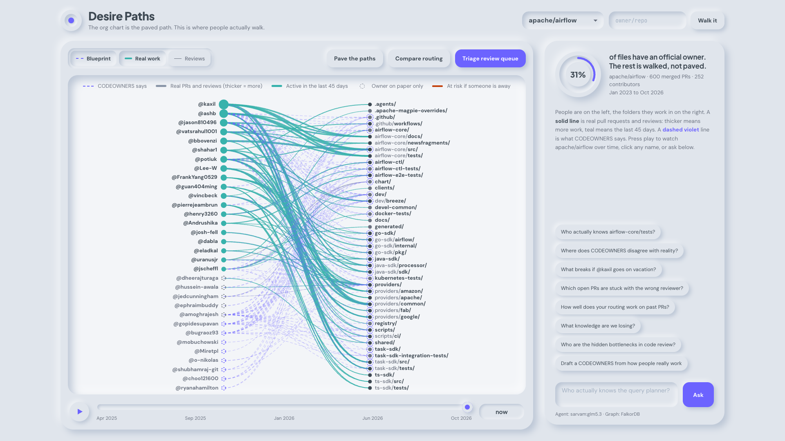
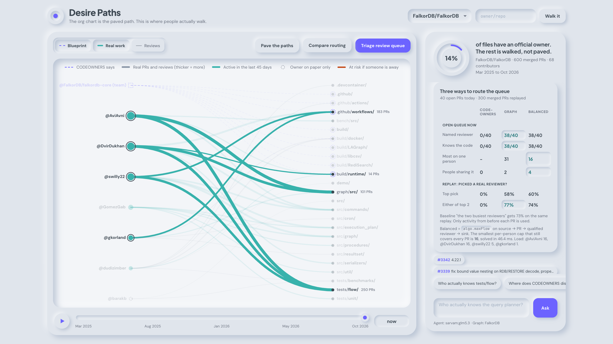
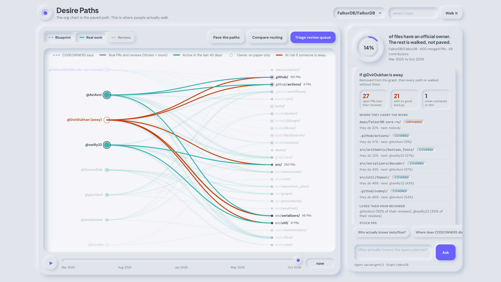
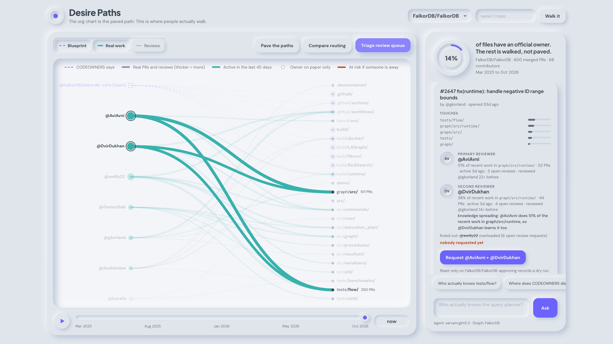

# Desire Paths

**An agent that knows how a software project really works, decides who should review what, and acts on it.**

On FalkorDB's own repository, it found:

- Only **14%** of files have an official owner.
- **17 of the 40** most recently updated open PRs are misrouted, and 16 of them have nobody asked to review.
- **AI reviewers wrote more reviews than all humans combined** (about 1,600).
- **56 of 64** suggested reviews land on two people, even with load balancing.
- If one of those two goes on vacation, **27 open PRs lose their reviewer and 21 have no good backup.**

Replayed on 300 merged PRs, the agent's top two picks include a person who really reviewed **77%** of the time on FalkorDB (CODEOWNERS: 0%, because it names only a team).
On Apache Airflow it reaches **44%**, against **26%** for CODEOWNERS.

**Live demo:** https://responded-voip-psp-led.trycloudflare.com/?repo=FalkorDB/FalkorDB

**Demo video (2 min):** [docs/desire-paths-demo.mp4](docs/desire-paths-demo.mp4)

A real action it took: [a paved CODEOWNERS pull request](https://github.com/addu2612/FalkorDB/pull/1) on a fork of FalkorDB, opened from the app after one click of approval.

In urban planning, a *desire path* is the dirt trail people wear across the grass when the paved path goes the wrong way.
Good planners don't put up fences.
They pave the trail.

Every repository has a paved path: `CODEOWNERS`, the team page, the org chart.
And every repository has desire paths: who actually writes, reviews and fixes each part of the code.
Desire Paths loads both into one FalkorDB graph, shows where they disagree, and gives an agent the graph tools to make routing decisions and take action on them.

Built for **Graph Hacks: Context for AI Agents** (WeMakeDevs x FalkorDB), entered in Track 01: *Agents That Act on Connected Data*.



## What it found on real repos

On **FalkorDB/FalkorDB** (600 merged PRs, Mar 2025 to Oct 2026):

- Only **14%** of files have an official owner.
  `CODEOWNERS` covers `build/` and `.github/`; the query engine, runtime and tests have no owner on paper.
- **17 of the 40** most recently updated open PRs are misrouted, 16 of them with nobody asked to review.
  One has waited 53 days.
- AI reviewers (CodeRabbit, Copilot and others) wrote about 1,600 reviews, more than all humans combined.
  They are labelled and kept out of the people analysis.
- Even with load balancing, 56 of 64 suggested reviews land on two people.
  The max-flow plan proves the floor: in any assignment that covers the 38 routable open PRs, someone carries at least 16, because almost nobody else has walked that code.
- **If @DvirDukhan is away, 27 open PRs lose their reviewer, and 21 of them have no good backup.**
  @AviAvni loses the person behind 95% of the recent reviews on their code.
- **Knowledge is fading in `src/arithmetic`:** one person wrote all 101 PRs across its 12 subfolders and has not touched it in 4 months.

On **apache/airflow**:

- `CODEOWNERS` is dense (31% of files), yet **112 review requests** in the open queue go to people with no recent work in the code those PRs touch.
- On today's queue, CODEOWNERS names someone with recent work in the touched code for 15 of 40 PRs; the graph does for all 40.

## Does the routing work? A backtest

For each merged PR, the backtest rebuilds every person's desire paths from activity *before* the PR was opened, hides who reviewed it, and checks whether a strategy's top two picks include someone who actually did.
Nothing from the future leaks in.

| 300 merged PRs | FalkorDB | Airflow |
|---|---|---|
| CODEOWNERS | 0% (names only a team) | 26% |
| The two busiest reviewers | 73% | 24% |
| **Desire paths (graph)** | **77%** | **44%** |
| Desire paths + load balancing | 74%, spread over 11 people instead of 6 | 37%, over 74 people instead of 33 |

The "busiest reviewers" baseline is strong on FalkorDB because two people do 65% of the reviews.
The graph still beats it, and beats it by a wide margin on a large project like Airflow.
Load balancing gives up a little accuracy to spread the work, which is the point.
Ask *"How well does your routing work on past PRs?"* or press **Compare routing** to run it live.



## What the agent does

**Decide.**
`route_pr` walks a multi-hop path through the graph for a live PR:

```
(:OpenPR)-[:TOUCHES {weight}]->(:Area)<-[:WORN {score, last}]-(:Person)<-[:REQUESTS]-(other :OpenPR)
```

It picks a primary reviewer by fit (share of recent, decayed work in the touched areas, weighted by how much of the change lands there), discounted by inactivity and by current review load, with a small bonus for having reviewed the author before.
If the primary does most of the work in the main area, the second reviewer is chosen to **spread knowledge** instead of piling on.
Every decision comes with the chain of evidence, the PRs behind it, and who was ruled out and why (inactive, overloaded, author).

**Act at scale.**
`triage` sweeps the open review queue and flags PRs that are unrouted, waiting on an absent reviewer, or assigned to someone with no history in that code.
Suggestions are assigned greedily with simulated load, so the queue spreads across the team.

`compare_routing` routes the whole queue three ways and puts them side by side: CODEOWNERS, the best graph fit, and a balanced plan.
The balanced plan is a max-flow problem solved by FalkorDB's `algo.maxFlow`:

```
(:Src) -[cap 1]-> (:PR) -[cap 1]-> (:Reviewer qualified for it) -[cap K]-> (:Snk)
```

The agent searches for the smallest per-person cap `K` that still covers every PR that can be covered, so no one carries more than they must.
The flow network is projected into a scratch graph and dropped after the solve (about 30 ms).

**Plan for absence.**
`if_gone` removes a person from the graph and walks it again.
It returns the open PRs that get stuck and whether each one has a good backup, the areas that are orphaned or thin, who covers each area next, and whose code loses its main reviewer.
On the map, they are marked "away" and their lines turn red.


`fading_paths` finds the same risk in slow motion: areas whose main expert has stopped walking them, and whether anyone has picked the work up.

**Help newcomers in.**
`onboard` gives the way into an area: who reviews there and is active, the small, well-discussed PRs to read first, the areas that usually change with it, and the shortest chain of review relationships to the right person.

**Act.**
The agent proposes; a person approves with one click; the server checks GitHub write permission and executes:

- request reviewers on the PR, or
- open a pull request with a `CODEOWNERS` file "paved" from the desire paths (on your fork if you can't push upstream).
  Paving only adds: it edits the `CODEOWNERS` file GitHub actually reads, keeps every existing rule unchanged and last (so security rules on CI and build files keep their force), and adds lines only for code nobody owns today.
  [Example on a fork of FalkorDB](https://github.com/addu2612/FalkorDB/pull/1).

Without write access it records a dry run and changes nothing.
Every attempt is stored in the graph as an `(:Action)` node linked to the PR, so the agent knows what it already did.



**Explain and answer.**
Ask in plain language: *Who actually knows the execution plan? What breaks if @x goes on vacation? Where does CODEOWNERS disagree with reality?*
The agent picks tools, walks the graph, cites PRs, and the map lights up the exact path it reasoned along.

**Show the proof.**
Every answer and card has a *Graph proof* drawer with the exact Cypher queries the tools ran on FalkorDB, their parameters, row counts and timings.
Nothing the agent says is a black box: you can paste any of them into FalkorDB Browser and get the same rows.

## Reading the map

- **People are on the left, the folders they work in on the right.**
- **Solid lines** are real pull requests and reviews. Thicker means more work; teal means active in the last 45 days, grey means older.
- **Dashed violet** lines are what `CODEOWNERS` says.
- **Dashed circles** are owners on paper only: named in `CODEOWNERS`, with no recent work.
- Press **play** to watch 18 months of the repo: lines form, thicken, and fade as people move on. The decay is computed in the browser from the same per-PR events the backend uses.
- **Pave the paths** colours the lines violet and drafts the `CODEOWNERS` that would make the file match reality.
- To stay readable, the map shows the 22 busiest folders and 16 busiest people; work in smaller folders is folded into their parent folder.

## Why a graph

Each question is a traversal, not a lookup:

| Question | Graph work |
|---|---|
| Who should review PR #3120? | PR -> files -> areas -> people -> their open review load |
| What breaks if @x is away? | the same walk for every open PR, with @x removed |
| How do we split the queue fairly? | `algo.maxFlow` on a PR -> reviewer flow network |
| Who actually knows `src/execution_plan`? | recency-decayed `WORN` edges vs. `OFFICIAL` edges |
| Who are the hidden bottlenecks? | `algo.betweenness` on the reviewer -> author graph |
| Whose review matters most? | `algo.pageRank` on `COLLAB` |
| Which groups never review each other? | `algo.labelPropagation` communities |
| How do I get an intro to @x? | `algo.SPpaths` over review relationships |
| Who knows "vector index"? | full-text index on PR titles, then traverse to people |

### Graph model

```
Blueprint   (:Team|:Person)-[:OWNS]->(:File)            from CODEOWNERS (last match wins)
            (:Team|:Person)-[:OFFICIAL {coverage}]->(:Area)

Activity    (:Person)-[:AUTHORED|MERGED]->(:PR)
            (:Person)-[:REVIEWED {state, at}]->(:PR)
            (:PR)-[:TOUCHED]->(:File)-[:IN]->(:Area)-[:IN]->(:Area)
            (:PR)-[:CLOSES]->(:Issue)<-[:OPENED]-(:Person)

Derived     (:Person)-[:WORN {score, prs, last}]->(:Area)    recency decay, 120-day half-life
(Cypher)    (:Person)-[:COLLAB {n, score}]->(:Person)       reviewer -> author

Live queue  (:Person)-[:OPENED_PR]->(:OpenPR)-[:TOUCHES {weight}]->(:Area)
            (:OpenPR)-[:REQUESTS]->(:Person|:Team)
            (:Action {kind, status, at})-[:FOR]->(:OpenPR)
```

Humans carry a `:Human` label and bots a `:Bot` label, so graph algorithms can be scoped to people.
Each repository is its own isolated FalkorDB graph.

## MCP

All tools are exposed over MCP, so any agent can use the graph.

- HTTP: `https://<your-deployment>/mcp` (streamable HTTP)
- stdio: `uv run desire-paths-mcp`

Claude Desktop / Cursor config:

```json
{
  "mcpServers": {
    "desire-paths": { "command": "uv", "args": ["--directory", "/path/to/Desire-Paths", "run", "desire-paths-mcp"] }
  }
}
```

Tools: `list_repos`, `who_knows`, `who_knows_topic`, `route_pr`, `triage`, `compare_routing`, `backtest`, `if_gone`, `fading_paths`, `onboard`, `blueprint_drift`, `bus_factor`, `hidden_bottlenecks`, `person`, `intro_path`, `pave`, `request_reviewers` (plan by default, `confirm=true` to execute).

## Run it locally

Requirements: Docker, [uv](https://docs.astral.sh/uv/), and the GitHub CLI logged in (or a `GITHUB_TOKEN`).

```bash
docker run -d -p 6379:6379 falkordb/falkordb:latest
cp .env.example .env              # add an LLM key (see below)
uv sync
uv run python -m desire_paths.graph   # builds graphs from the cached snapshots in data/
uv run desire-paths                   # http://localhost:8000
```

Load any public repo from the UI ("Walk it"), or from the shell:

```bash
uv run python -m desire_paths.graph owner/name
```

Or run everything in one container (FalkorDB + app):

```bash
docker build -t desire-paths .
docker run -p 8000:8000 --env-file .env desire-paths
```

### LLM

Any OpenAI-compatible endpoint works; the agent uses native tool calls and falls back to JSON tool requests for models that lack them.

| `LLM_PROVIDER` | Endpoint | Default model |
|---|---|---|
| `sarvam` | Sarvam v2 | `glm5.3` |
| `subq` | Subquadratic | `subq-1m-preview` |
| `ollama` | local Ollama | `gemma4:e2b` |
| `custom` | `LLM_BASE_URL` | `LLM_MODEL` |

`auto` (the default) picks the first provider with a key and falls back to local Ollama.

## Project layout

```
src/desire_paths/
  github.py      GitHub GraphQL: merged PRs, reviews, files, issues, open PRs, CODEOWNERS
  graph.py       builds both layers in FalkorDB and derives desire paths with Cypher
  tools.py       graph tools: routing, triage, what-ifs, drift, centrality, communities, paths
  strategies.py  backtest and max-flow balancing, CODEOWNERS vs. graph vs. balanced
  actions.py     permission-checked GitHub writes, recorded as (:Action) nodes
  agent.py       tool-calling agent loop over any OpenAI-compatible model
  mcp_server.py  the same tools over MCP
  server.py      FastAPI: graph view, streaming agent, actions, ingest, /mcp
web/             the worn-grass map (force-graph on canvas) and the agent panel
data/            cached GitHub snapshots so the demo runs offline
```

## Use of AI tools

In line with the hackathon rules, we disclose that this project was built with help from an AI coding assistant (Claude Code).
It was used for writing and refactoring code, the UI, the README, and producing the demo video (the narration is local Kokoro text-to-speech, the video is composed with HyperFrames).
The idea, the graph model, the product decisions, and the checks of every number in this README were ours; all results come from running the code against FalkorDB on public GitHub data.
At runtime, the in-app agent uses GLM 5.3 through Sarvam to choose which graph tools to call and to word its answers; every fact it states comes from the Cypher queries shown in its *Graph proof* drawer.
